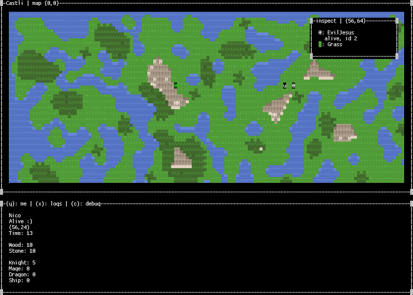

**Castli**
Ongoing project of a multiplayer terminal based strategy game.

**How to build and run**
You will need to have the Rust toolchain installed.

Open a terminal and run the following command from the project root:
cargo run --bin server

Open a second terminal and run the client from the project root:
cargo run --bin client

**Controls**
`q`: quit
`l`: toggle inspect mode
`M`: switch to world map
`m`: switch to map
`k`: switch to courtyard
`Arrow keys`: move camera in standard mode; move inspect cursor in inspect mode
`Ctrl` + arrow keys: move camera or inspect cursor by a factor of 8
`Enter`: use intuition
`Esc`: exit inspect or interaction mode
`y`: Castle tab
`x`: Logs tab
`c`: Debug tab
